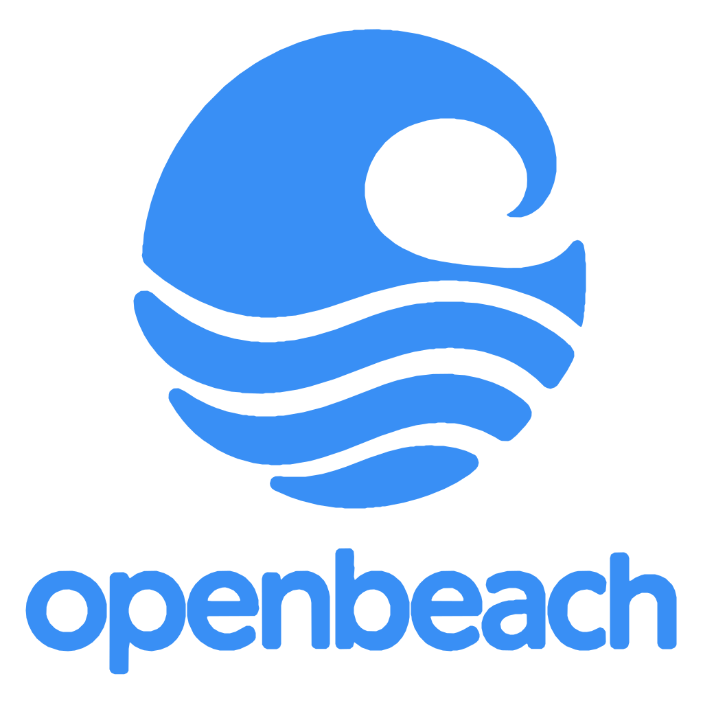
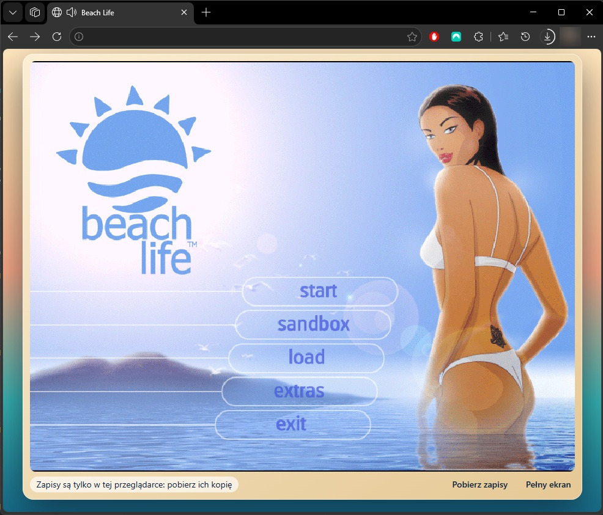
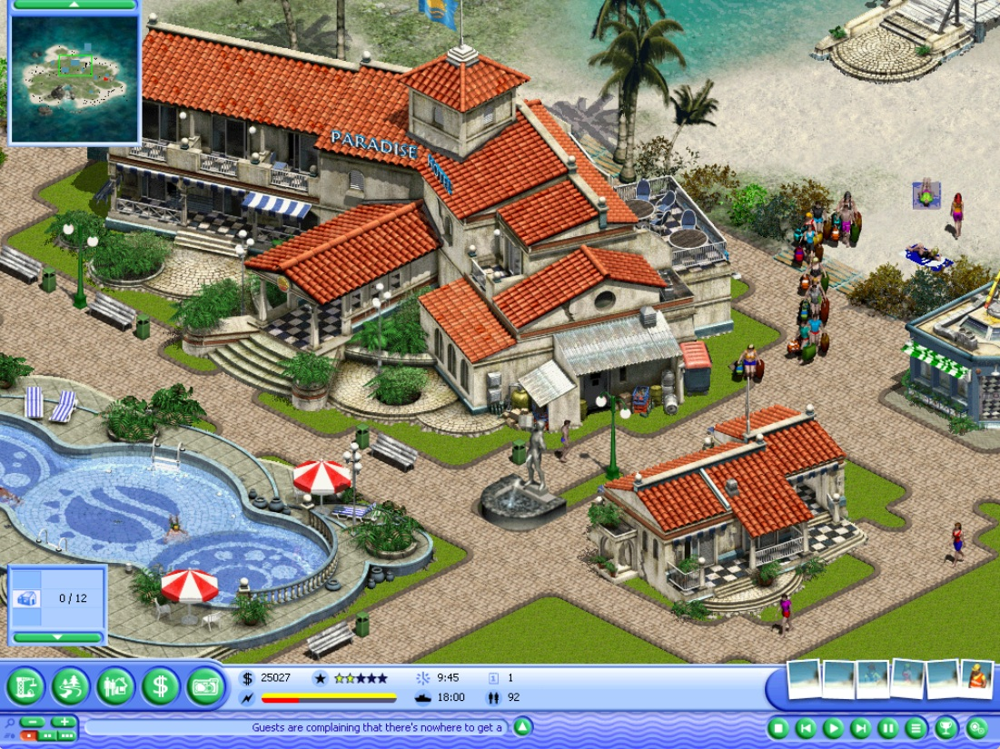
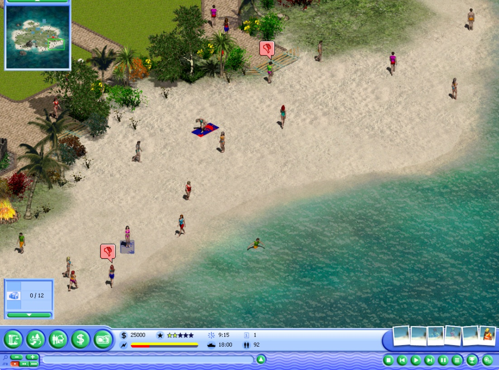

<p align="center"></p>

<p align="center"><b><a href="https://openbeach.app">Play in your browser: openbeach.app</a></b></p>

<p align="center">Open the page and drop your own Beach Life disc image (.iso).<br>
It works on Windows, macOS and Linux, in any modern browser.</p>

<p align="center">
  <a href="https://github.com/h4570/openbeach/actions/workflows/ci.yml"></a>
  <a href="https://github.com/h4570/openbeach/releases"></a>
  <a href="LICENSE"></a>
  <a href="https://discord.gg/PtJqgwGtZm"></a>
</p>

<p align="center">
  
  
  
  
  
  
  
</p>

# OpenBeach

An open reimplementation of **Beach Life** (Deep Red Games / Eidos, 2002), the beach-resort management game, written in
C++20 with SDL3. It runs on Windows, on Linux and in the browser, and has a headless simulation that plays whole
scenarios without a window, graphics or sound.

<p align="center"></p>

<p align="center">
  
  
</p>

## What you need
Apart from the screenshots above, the repository contains **no assets of the original game** (no graphics, music, video,
texts or scenario data). To play
the original scenarios you need your own copy of Beach Life: an installed copy or the disc image. A converter reads it
once and writes open formats (JSON, PNG, OGG) that the game loads; old saves convert too
([game data](docs/build/game-data.md)).

The game also ships a small scenario of its own, the **L0 pack**: a minimal map and building set that needs no original
data. It is what the automated tests use, and it runs on the same mechanics as the full scenarios
([L0 tests](docs/build/ci-l0.md)).

## Building and running
Details and the WebAssembly build: [building](docs/build/building.md).

### Windows
Windows 10/11 needs Visual Studio 2026 with "Desktop development with C++", Python 3.11+, PowerShell 7 and Git.

```powershell
./build.ps1                                  # x64 Debug (./build.ps1 -Config release for RelWithDebInfo)
$bin = "./build/x64/bin/Debug"
New-Item -ItemType Directory -Force run/packs/base, run/remaster | Out-Null
& $bin/obl-convert.exe import "<your Beach Life folder>" run/packs/base      # converts your copy, about 15 minutes
& $bin/obl-convert.exe resources "<your Beach Life folder>" run/remaster     # window icon and cursors
& $bin/OpenBeach.exe --game-dir run      # play
```

### Linux
x86-64 Linux needs Clang, CMake, Ninja, Python 3 and Git, plus SDL's X11 or Wayland development packages for a real window.
The Linux game is built and started in testing without a display, so a window, sound and input there are not yet proven.

```bash
OBL_SIM_SKIP_CONVERSION=1 bash tools/obl_sim_linux.sh -DOBL_LINUX_WINDOWED=ON   # Debug build
bin=build/linux-sim-x64/bin
mkdir -p run/packs/base run/remaster
$bin/obl-convert import "<your Beach Life folder>" run/packs/base      # converts your copy
$bin/obl-convert resources "<your Beach Life folder>" run/remaster     # window icon and cursors
$bin/OpenBeach --game-dir run      # play
```

Window or borderless fullscreen, window scale, frame cap and the intro movie are set in `run/openbeach.ini`
([settings](docs/build/settings.md)); the resolution is changed in game under Options -> Video. More on starting the
game and the hidden/headless modes: [running the game](docs/build/running-the-game.md).

The browser version imports your own copy in the page and keeps it on your machine: [browser build](docs/architecture/browser-build.md).

## Documentation
Start at [docs/index.md](docs/index.md). Tests are described in [unit tests](docs/testing/unit-tests.md).

## Repository layout
| Directory | Content |
|---|---|
| `src/core`, `src/common` | portable helpers without game concepts |
| `src/game` | the game modules and the simulation core |
| `src/platform` | Windows/SDL backends and host services |
| `src/testing` | the scripted-test interpreter and headless simulation |
| `src/launcher` | `OpenBeach.exe` (the game) |
| `tests/` | game test scripts, unit tests, tool tests, golden references |
| `tools/` | build, test and data scripts |
| `docs/` | documentation |
| `assets/logo/` | the OpenBeach logo: full (`openbeach-logo.svg`), mark alone, wordmark alone |

## Licence
GPL-3.0-or-later; the text is in [LICENSE](LICENSE). Third-party components and their licences: [THIRD_PARTY_NOTICES.md](THIRD_PARTY_NOTICES.md).

Beach Life is a trademark of its rights holders. This project is not affiliated with or endorsed by them.
